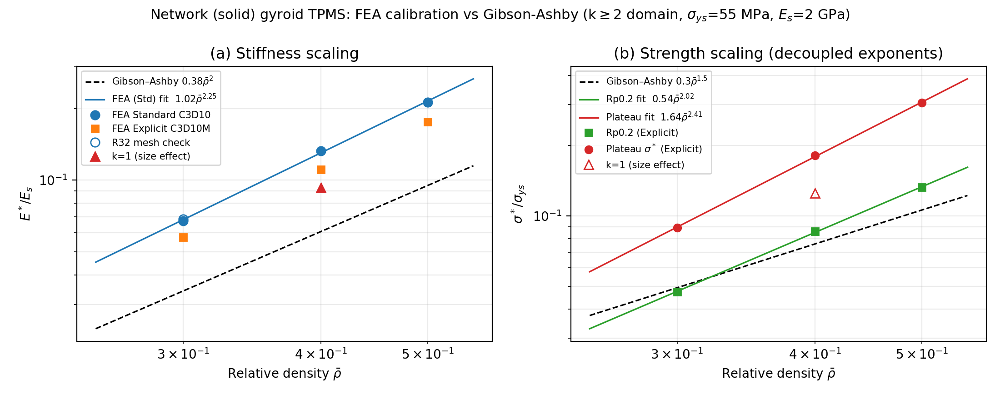

# FEA 标定组 — network gyroid 幂律（双求解器 + 尺寸效应）

> 生成：2026-10-31 工位 ABAQUS 2025 八轮实验（线弹性闭环→大应变定界→E\* 扫参→摩擦终判→
> Explicit 全闭环→C2 扫参→k 维尺寸效应）｜实验全记录 [plans/2026-10-30_GA-C1扫参标定.md](../plans/2026-10-30_GA-C1扫参标定.md)
> 与 [plans/2026-10-30_大应变压缩-全特征验证.md](../plans/2026-10-30_大应变压缩-全特征验证.md)
> ｜反演报告 [fit-report.md](fit-report.md)（单点）/ [fit-report-expl.md](fit-report-expl.md)（四点）
>
> **术语更正（2026-11-01 独立复核）**：本标定几何为 p0 场 `f≥c` 单侧实体 = **network（solid）
> 形态**，非 sheet（薄壳 |f|<t，未实现）——初版文档误称 "sheet gyroid" 已全篇更正。
> 文献指数带 n≈2.0~2.3 系 **sheet 类**报道，对 network 形态仅作方向性参考（同为连续曲面
> 承载、区别于 strut），"落带中"的强断言撤回。

## 结论表

| 量 | FEA 幂律 | Gibson–Ashby | 指数差 | 说明 |
|---|---|---|---|---|
| E\*/Es | **1.02·ρ̄^2.25** | 0.38·ρ̄² | +0.25 | Standard C3D10 线弹性四点（p70 含 R32 网格加密判别 +1.7%） |
| E\*/Es | 0.81·ρ̄^2.19 | — | — | Explicit C3D10M 口径（**较 Standard 低 17%——单元类型+求解范式混合口径差，归因待敏感性验证**，指数互证一致） |
| Rp0.2/σys | **0.54·ρ̄^2.02** | — | — | Explicit 三点；屈服 bending 型 |
| 平台σ/σys | **1.64·ρ̄^2.41** | 0.3·ρ̄^1.5 | **+0.9** | Explicit 三点；屈曲加权，GA 严重低估衰减速度 |

## 核心发现

1. **强度–刚度衰减解耦**：刚度指数 2.25（纯几何标度微调），平台应力指数 2.41（低密度下
   弹性屈曲替代塑性坍塌承载）——FEA/GA 平台比随 ρ̄↑ 增大（1.81→2.88×），刚度侧
   方向相反（2.24→1.98×）；
2. **单一 GA 公式两量都拟合不了**：屈服（2.02）与平台（2.41）本身分化——GA 修正须换
   指数族而非平移常数（**2026-10-31 用户拍板后 estimate 已替换**：gyroid 主口径=
   FEA 幂律，`plateauStressMPa`/`plateau_over_sigmas` 新字段双列披露，GA 对照值保留于
   `feaCalibration` 字段；其他 25 族无 FEA 证据不动）；
3. **尺寸效应与经典相反**：k1（1 胞）显著偏软（E\* −16%/平台σ −31%）——1 胞试件顶底只切
   到曲面单一相位（不对称截面），薄弱相位直接暴露在加载面；**适用域暂定 k≥2**
   （k2→k3/k4 收敛性未测，见判别验证待办）；
4. **跨范式可信度（强度侧）**：Rp0.2 在 Explicit（C3D10M+质量缩放 46×）与 Standard
   （C3D10+隐式）两个独立数值路径下仅差 0.9%（4.73 vs 4.69 MPa）——刚度侧两口径差 17%
   尚不能全部归因于单元偏软（见判别验证待办）。

## diamond 族扩展（进行中，2026-11-01 启动）

- 动机：specimens S3_D60/S4_D75 的试验参照空白；p0_generate.py 扩 `--type diamond`
  （与平台 tpms-functions.ts 同源四项式），diamond p60 验证 52,194 面水密 dev=0.89pp；
- 同参口径（gyroid 轮一致：Explicit T=5ms/dt=2e-7/μ=0.3，k2R24）；
- ⚠ **p50 前处理拒绝（三份网格定论）**：单元 36886/71236 近退化（质量 ≈9.4e-28、
  最大角 180°，d60le_p50.dat:1016）——R24 缺省/放宽 lmax0.8/真加密 lmax0.3（176,689
  单元，畸变 2→3 个同量级）**三份网格被 Explicit 前处理一致拒收**：Gmsh tet10 管线对
  diamond p50 几何特征（等值面-盒边界交线）的产出限制，非密度参数可解；Standard 线
  弹性容忍（三点 E\* 已收，p50 点带 2 近退化单元的证据瑕疵如实披露）；**下一步选项
  （2026-11-01 Codex 第五轮定案）**：本阶段停止 p50 补算并归档；~~Explicit 换 C3D4M~~
  （**C3D4M 不存在于 Explicit 单元索引——初版选项错误撤回**）；Netgen 优化重剖不排期；
  几何圆角（改几何不采纳）；
- **E\* 三点拟合（Standard 口径，名义密度）：E\*/Es ≈ 0.8509·ρ̄^2.1979**（Codex 独立回归一致）；
  **密度定义敏感性披露**：STL 实测固相 0.4987/0.3911/0.2898 vs 名义 0.5/0.4/0.3——换实测
  密度重拟合指数变 ≈2.07（Codex 复算）——**密度口径固定前 2.20 不与 gyroid 2.25 作"互证"
  强断言**；正式标定统一网格实测密度（两族同法）后重比；
  **系数比≠曲线比**：按当前两拟合线，标定域内刚度差 11%~14%（初版"系数低 17%"系
  系数口径，非同密度曲线差）；
  强度侧 Explicit 仅两点（p60/p70：平台 8.1/4.5 MPa、Rp0.2 4.8/2.8）样本不足暂不入库；
- **代码入库（2026-11-02 刚度单独放行轮落地）**：C1_MAP[diamond] 0.42→0.8509 /
  GA_EXPONENT_MAP[diamond]=2.1979（名义密度口径，与 gyroid 代码先例一致；实测密度敏感性
  0.7871·ρ̄^2.0709 双披露）；estimate `model`/`feaCalibration` 双字段 diamond 分支（GA 0.42 对照值保留）；
  selftest 标度律锚改 (0.5/0.2)^2.1979 + 新增 schwarz 缺省档 ρ² 不变量锚（63/0）；
  FEA_STRENGTH 不加（强度侧两点暂不发幂律）。estimate diamond 预测由 GA 0.42·ρ̄² 更新为
  FEA 0.8509·ρ̄^2.1979（ρ̄=0.6 时 ≈1.79× 上修）。

## diamond 阶段定稿（2026-11-01，Codex 第四轮批准范围）

> **定稿语义：带质量限制的初步数值结果与失败边界——尚非经网格验证的 diamond 标定律。**
> p50 精确措辞（Codex）：当前 Gmsh 管线生成的三份 diamond p50 网格，在所测试设置下均被
> Abaqus/Explicit 前处理拒收，本阶段停止该点补算（"等值面-盒边界交线"属待定位机制解释）。

**候选刚度数据（Standard 三点，逐点存档）**：

| ρ̄（STL 实测） | 名义 | E\*（MPa） | sha256(前12) |
|---|---|---|---|
| 0.49870 | 0.50 | 373.3 | 249758190e06 |
| 0.39110 | 0.40 | 224.6 | 3cb93a21c905 |
| 0.28984 | 0.30 | 121.3 | 9a5d4e64124a |

（p50 点带 2 近退化单元证据瑕疵如实披露；FE/STL 体积比六件全 = 1.000000 ✓）

**双口径拟合（两族同法对照）**：

| 族 | E\*/Es（STL 实测密度） | 逐点残差(log) | E\*/Es（名义密度，敏感性对照） |
|---|---|---|---|
| gyroid | **0.9914·ρ̄^2.2028** | -0.0042/+0.0073/-0.0031 | 1.0236·ρ̄^2.2504 |
| diamond | **0.7871·ρ̄^2.0709** | +0.0017/-0.0030/+0.0013 | 0.8509·ρ̄^2.1979 |

- **密度口径敏感性**：diamond 指数 2.20（名义）↔2.07（实测）——口径固定前不与 gyroid
  作"互证"强断言；两族同口径（实测）下指数差 0.13（2.20 vs 2.07），同口径（名义）下
  差 0.05——哪种口径物理更正确属后续方法学决策（实测=FE 实解几何，名义=solve_level
  目标；FE/STL 体积比 1.0 已核对，实测口径具备背书条件）；
- **标定域内两族刚度差（实测口径，曲线比）**：diamond/gyroid =
  (0.7871/0.9914)·ρ̄^(2.0709−2.2028) → ρ̄=0.3~0.5 内 **低 7%~13%**（含指数差贡献；
  系数单独比 0.79 不等于曲线差——2026-11-01 二次更正，同款系数比误用勿再犯）；
- **逐点残差定义**：`ln(E_data/E_fit)`（三点拟合内对数残差，±0.0073 内）——**非网格
  误差或模型验证精度**；
- 强度侧：Explicit 两点逐点存档（p60 平台 8.1/Rp0.2 4.8；p70 平台 4.5/Rp0.2 2.8
  MPa），**暂不发强度幂律**；
- **放行条件（Codex 定）**：刚度单独放行、不等强度第三点；依据=刚度自身质量证据
  （p50 近退化单元定位处理+密度口径定案）；**主公式替换继续暂缓**。

## 口径与适用域（诚实边界；2026-11-01 独立复核更正）

- **形态**：network（solid）gyroid——p0 场 `f≥c` 单侧实体；sheet（薄壳）形态未实现，
  文献 sheet 类指数带对本标定仅方向性参考；
- **分辨率定义（更正）**：p0 的 R=**每周期格数**——k2R24 = 24 格/周期（非初版误写的
  12）；specimens/S1_G60 = k8 R96 = **12 格/周期**。标定组保真度**高于**试样：对比时
  试样侧含更粗几何离散（方向=试样偏软），叠图超差先查此项（初版"两者同档直接可比"
  论据撤回）；
- 几何：gyroid k2 R24（333,886 节点/212,209 C3D10，minSICN=0.0572）；材料：示例 PLA
  （E=2000 MPa/ν=0.3/ρ=1.24e-9 tonne/mm³/*PLASTIC 硬化 55–70 MPa）——**E\* 侧无量纲
  指数为线弹性几何标度结论**；**强度侧指数依赖示例 PLA 本构形状（硬化/屈服比），跨材料
  迁移证据不足（2026-11-01 复核收紧）**，跨材料引用须按实际本构重标定；
- Explicit 准静态能量证据（**2026-11-01 按 odb history 重算更正**；初版"末段 0.85%"
  系 .sta 的 KE/TOTAL ENERGY 列误读，非 KE/IE）：
  - 平台段（ε 20%~40%）KE/IE 平均 **0.475%**/最大 0.704%，终点 ≈0.000125%——准静态
    主承载段证据充分；
  - **初始弹性段（ε 0.2%~1%）KE/IE 平均 9.69%/最大 17.08%——超 10% 纪律**，初始刚度
    点（E\*）的准静态性待加载时间与质量缩放敏感性验证（见判别验证待办）；
  - ALLPW<0.02% ✓；
- 密度域 ρ̄∈[0.3, 0.5]（三点）/ k≥2（k2→k3/k4 待验证）/ 压缩单轴（无剪切/多向）；
- εd 未观察（45% 应变未密实化）——W 系截至 ε=0.451 积分，非"至密实化吸能"；
- Standard 隐式压至 ε≥0.40 不可达（三路线 17~21% 应变死点齐，见大应变 plan 定界终表）；
- estimate CLI 的 `feaCalibration` 字段（gyroid）自动携带本表结论；
- **数字孪生压溃卡与 SEA 卡已分族迁移（2026-10-31 第二批）**：`type` 参数使平台参照走
  FEA 幂律（gyroid），缺省保持 GA 向后兼容；**DT/FEA 参照比 [0.6, 0.95] = 固定 R6 算例
  回归容差（2026-11-01 Codex 复核降格）**——单收敛点 ρ̄=0.35 实测 0.798，非标定带；
  **两侧条件未匹配**（Codex 对照表）：几何（单周期 R6 体素 vs k2）/屈服比 σy/E（0.008 vs
  0.0275）/应力统计窗（屈服后至 2.5% vs 20%~40% 平台窗）；且对密度口径敏感（名义
  ρ̄=0.35 实际固相 71/216=0.3287，换分母比变 0.928）——成带前须匹配实际密度/本构/
  边界/应变窗口+多收敛点+分辨率敏感性；置信度评价（Codex）：公式接线=高/固定算例
  重复=中/跨密度分辨率=低/跨材料迁移=证据不足；
- **逆设计同值验证的限定条件**：14.277≡14.277 GPa 系 **TC4、solid 模式、α=1** 下的
  前向核对——其他材料/模式（shell/gradient）/各向异性系数 ≠1 时前向值随参数变化，
  同源一致性由单源实现保证（同一 gibsonAshby 函数），非逐参数数值核对；

## 判别验证待办（2026-11-01 复核排定，按优先序）

1. **初始弹性段准静态性**：加载时间 T 敏感性（T=5→10→20 ms 单点 E\* 漂移）+质量缩放
   敏感性（dt=2e-7→1e-7）——归因 Explicit E\* 口径差 17% 中动态成分与单元成分；
2. **k 收敛性**：k3/k4 单点（同 por 0.6）——把"适用域 k≥2"升级为实测收敛结论；
3. **逆设计代理同源核对**：inverse-design.ts 与主面板公式差 2.70×（5.28 vs 14.28 GPa
  @por60/tc4）——单源纪律修复+α 兑现核对口径同步（进行中，见 progress）；
4. R48 单点网格收敛上限确认（可选，1.7M 单元成本高）。

## 复现

`sim/p0_generate.py → p1_mesh.py → p2_static_setup.py --explicit 5.0 --mass-dt 2e-7
--plastic --contact --friction 0.3 → abaqus → p2_extract_csv.py → fit-batch.mjs`；
图：`python sim/plot_calibration.py`；DT/FEA 带重实测：`tpms/.verify/probe_dt_fea_band.mjs`。

## 附录：算例资产绑定清单（2026-11-01 Codex 第五轮留证要求）

> STL sha12 = 生成该求解的初始几何哈希；INP"被覆盖"=同名文件被后续配置重写
> （STL 哈希+确定性管线为历史输入归属证据链）；CSV sha12=提取产物哈希。
> 体积可复跑：`python sim/probe_volume_check.py`（FE/STL 体积比六件全 1.000000）。

| 算例 | STL sha12 | INP 现状 | ODB | CSV sha12 | 口径 |
|---|---|---|---|---|---|
| gyroid p50 LE | 402bf44c4dd2 | 在 | ✓ | 62d03567f67c | E\* Standard |
| gyroid p60 LE | 3609c5192e3d | 在 | ✓ | 36d014bb637c | E\* Standard |
| gyroid p70 LE | a74114184690 | 在 | ✓ | 67a05c9bf123 | E\* Standard |
| gyroid p60 EXPL | 3609c5192e3d | 已被 LE 版覆盖 | ✓ | 4b2675fb428e | 全特征 Explicit |
| gyroid p50 EXPL | 402bf44c4dd2 | 已被 LE 版覆盖 | ✓ | e5198136ce11 | 全特征 Explicit |
| gyroid p70 EXPL | a74114184690 | 已被 LE 版覆盖 | ✓ | 0bdaa0db1ea4 | 全特征 Explicit |
| gyroid k1 EXPL | fe79dc21e604 | 在 | ✓ | da0937d3eb4a | 尺寸效应点 |
| diamond p50 LE | 249758190e06 | 已被 fine 版覆盖 | ✓ | f2423778d588 | E\* Standard（近退化瑕疵） |
| diamond p60 LE | 3cb93a21c905 | 已被 LE 版覆盖 | ✓ | 01a50d138c7d | E\* Standard |
| diamond p70 LE | 9a5d4e64124a | 已被 LE 版覆盖 | ✓ | d5b93bb9b2b2 | E\* Standard |
| diamond p60 EXPL | 3cb93a21c905 | 已被 LE 版覆盖 | ✓ | 6b7fc81d48e2 | 强度 Explicit |
| diamond p70 EXPL | 9a5d4e64124a | 已被 LE 版覆盖 | ✓ | 251de4efb9ed | 强度 Explicit |
