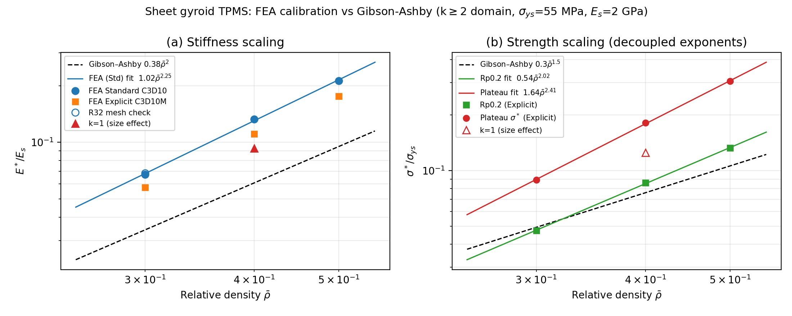

# FEA 标定组 — sheet gyroid 幂律（双求解器 + 尺寸效应）

> 生成：2026-10-31 工位 ABAQUS 2025 八轮实验（线弹性闭环→大应变定界→E\* 扫参→摩擦终判→
> Explicit 全闭环→C2 扫参→k 维尺寸效应）｜实验全记录 [plans/2026-10-30_GA-C1扫参标定.md](../plans/2026-10-30_GA-C1扫参标定.md)
> 与 [plans/2026-10-30_大应变压缩-全特征验证.md](../plans/2026-10-30_大应变压缩-全特征验证.md)
> ｜反演报告 [fit-report.md](fit-report.md)（单点）/ [fit-report-expl.md](fit-report-expl.md)（四点）

## 结论表

| 量 | FEA 幂律 | Gibson–Ashby | 指数差 | 说明 |
|---|---|---|---|---|
| E\*/Es | **1.02·ρ̄^2.25** | 0.38·ρ̄² | +0.25 | Standard C3D10 线弹性四点（p70 含 R32 网格收敛判别 +1.7%） |
| E\*/Es | 0.81·ρ̄^2.19 | — | — | Explicit C3D10M 口径（系数 -21%=单元偏软，指数互证一致） |
| Rp0.2/σys | **0.54·ρ̄^2.02** | — | — | Explicit 三点；屈服 bending 型 |
| 平台σ/σys | **1.64·ρ̄^2.41** | 0.3·ρ̄^1.5 | **+0.9** | Explicit 三点；薄壁屈曲加权，GA 严重低估衰减速度 |

## 核心发现

1. **强度–刚度衰减解耦**：刚度指数 2.25（纯几何标度微调），平台应力指数 2.41（低密度
   薄壁以弹性屈曲替代塑性坍塌承载）——FEA/GA 平台比随 ρ̄↑ 增大（1.81→2.88×），刚度侧
   方向相反（2.24→1.98×）；
2. **单一 GA 公式两量都拟合不了**：屈服（2.02）与平台（2.41）本身分化——GA 修正须换
   指数族而非平移常数（estimate CLI 已披露 FEA 口径，公式替换待拍板）；
3. **尺寸效应与经典相反**：k1（1 胞）显著偏软（E\* −16%/平台σ −31%）——1 胞试件顶底只切
   到曲面单一相位（不对称截面），薄弱相位直接暴露在加载面；**适用域定案 k≥2**
   （支架设计准则"每边 ≥2 周期"实证）；
4. **跨范式可信度**：Rp0.2 在 Explicit（C3D10M+质量缩放 46×）与 Standard（C3D10+隐式）
   两个独立数值路径下仅差 0.9%（4.73 vs 4.69 MPa）。

## 口径与适用域（诚实边界）

- 几何：gyroid k2 R24（333,886 节点/212,209 C3D10，minSICN=0.0572）；材料：示例 PLA
  （E=2000 MPa/ν=0.3/ρ=1.24e-9 tonne/mm³/*PLASTIC 硬化 55–70 MPa）——**无量纲幂律指数
  是纯几何侧结论**（对基体不敏感），系数随材料换算；
- Explicit 准静态：T=5 ms（速度 1.13 m/s=波速 0.09%）/VARIABLE MASS SCALING dt=2e-7
  （46×）/μ=0.3 摩擦 general contact；准静态判据末段 KE/IE=0.85~1%（ALLPW<0.02%）；
- 密度域 ρ̄∈[0.3, 0.5]（三点）/ k≥2 / 压缩单轴（无剪切/多向）；
- **k 口径衔接（2026-10-31 复核）**：标定组 k2R24 与 specimens/S1_G60（k8 R96）同为
  **12 格/周期**（保真度同档）；32 件试样 periods=8 全部满足 k≥2 准则（余量 4×），
  S1 上机无尺寸效应风险；k2→k8 的残余漂移未测（方向已知：k1 偏软→k 增方向收敛），
  试验点叠图时如超差先查此项；
- εd 未观察（45% 应变未密实化）——W 系截至 ε=0.451 积分，非"至密实化吸能"；
- Standard 隐式压至 ε≥0.40 不可达（三路线 17~21% 应变死点齐，见大应变 plan 定界终表）；
- estimate CLI 的 `feaCalibration` 字段（gyroid）自动携带本表结论；
- 复现：`sim/p0_generate.py → p1_mesh.py → p2_static_setup.py --explicit 5.0 --mass-dt 2e-7
  --plastic --contact --friction 0.3 → abaqus → p2_extract_csv.py → fit-batch.mjs`；
  图：`python sim/plot_calibration.py`。
