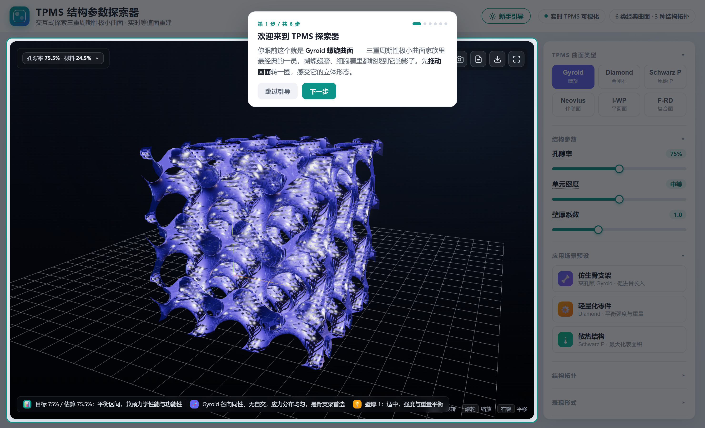
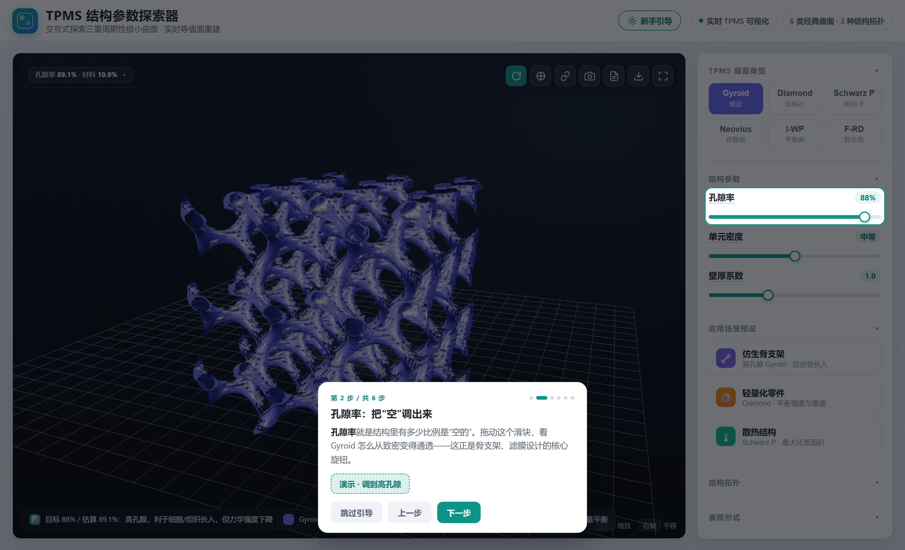
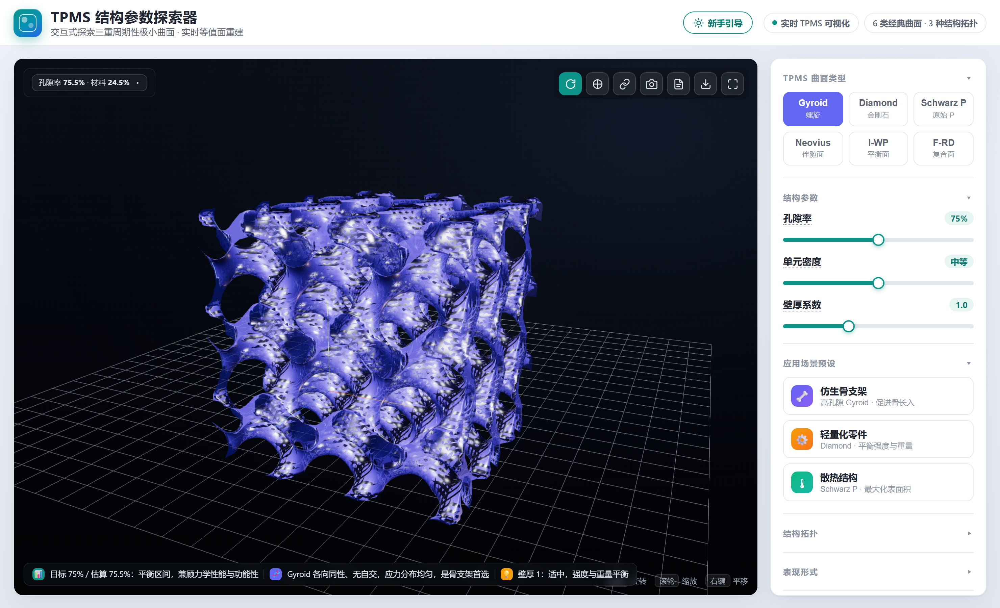
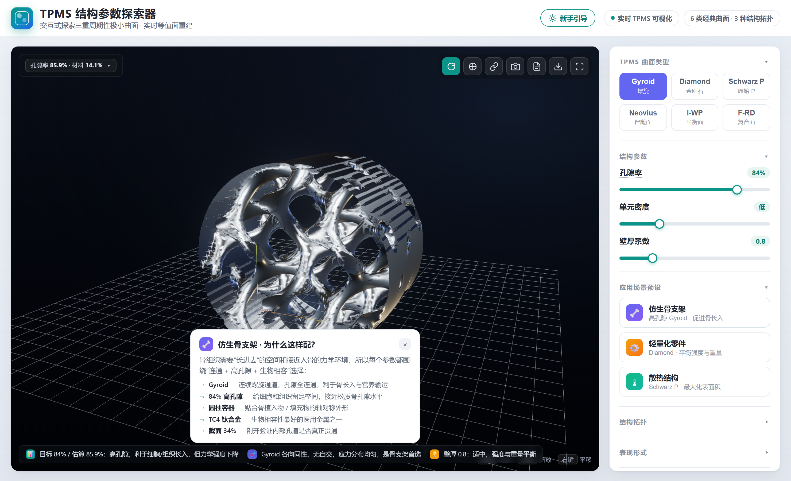
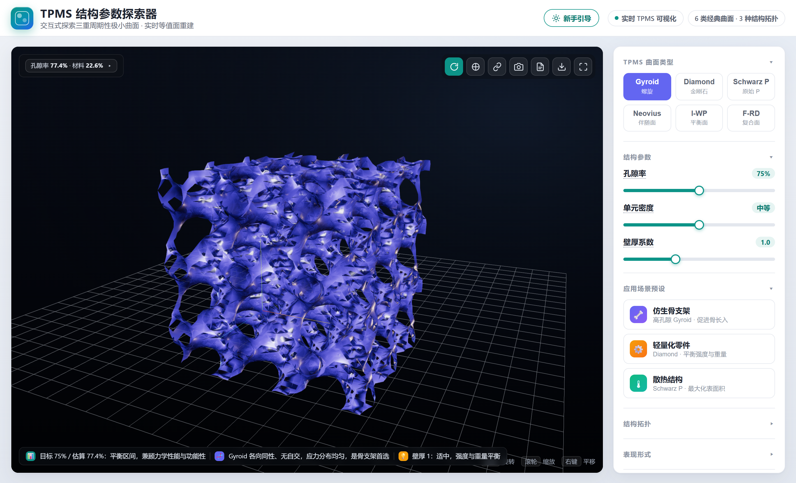
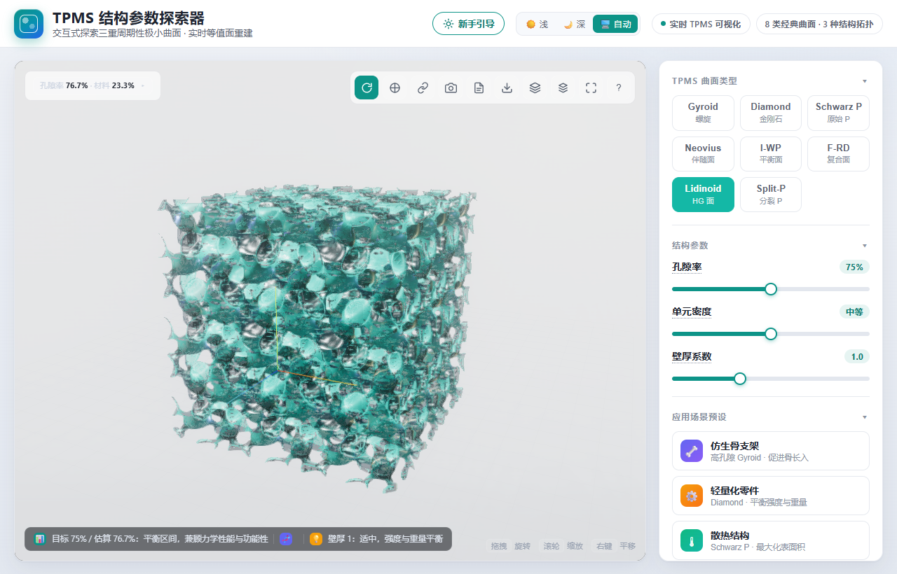
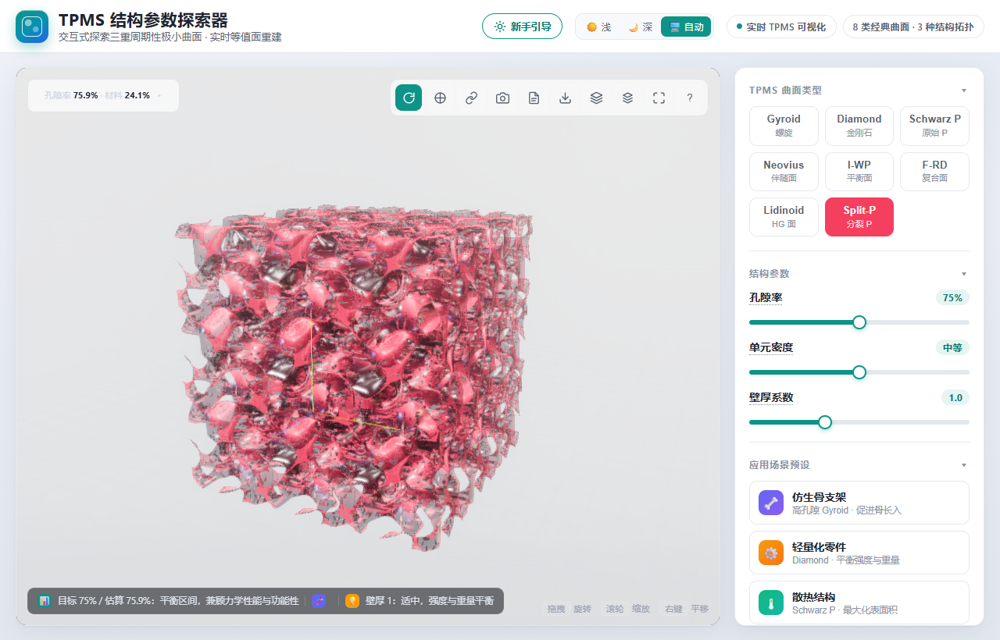
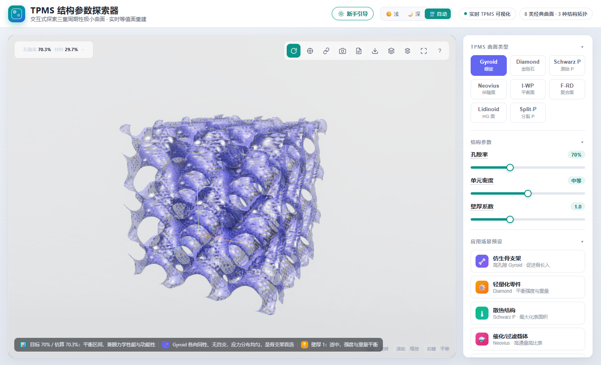

# TPMS Explorer · 工程中枢（tpms/）

> **面向开发者、二次研究者与贡献者**：工程化平台（Vite + TS + Three.js + WebGPU）、Agent CLI 工具链与自动化验证门禁体系都在本目录。
> 终端用户体验、在线入口与项目全景请看[仓库主页](../README.md)——48 道 CI 门禁、1000+ 断言的 verification-first 承诺由本中枢兑现。


---

## 🤖 AI Agent 闭环（M0-M5 全通）

**自然语言 → schema 逐槽位校验拦截器（越界拒绝） → 确定性 CLI 执行 → 门禁验证 → 有界修复循环**——LLM 只填意图槽位，一切数值由确定性代码生成或校验：

```
"设计一个孔隙率 75% 的 Gyroid 骨支架"
   → [拦截器：enum/范围/路径穿越逐槽位校验，越界即拒绝]
   → tpms_mesh 执行（Surface Nets 构建性水密）
   → 水密门：开放边=0 非流形=0 退化面=0 → 通过 → STL 交付（mm）
```

| 验收维度 | 结果 |
|---|---|
| 中英指令回归（43 条） | **glm-5.3-flash 多轮 43/43**（含 H 组逆设计意图用例；n=2 勿称确定性。历史五档矩阵 2026-10-01 为当时 37 条口径：4-flash 34/37×2 · 5.3-flash 37/37×2） |
| 对抗指令（路径穿越/越界/注入） | 四模型**零非法执行**（平台拒/模型拒/模型改发合法值三形态均零执行） |
| 拦截器自身 | 离线确定性门禁 40 断言（含 `../x.stl` 穿越写、裸 `..` 读、Win 设备名大小写实测拦截） |
| 闭环驱动器 | 注入缺陷方案 ≤5 轮自动收敛（LLM 只选修复策略，应用与验收全确定性） |

📘 技术叙事：[《44 道门禁：在 LLM 时代交付"真的能用"的科研工具》](../docs/blog/2026-09-16-44-gates.md)（红队实录与验证方法论）｜ [《从一句话到水密 STL：LLM Agent 的安全架构实录》](../docs/blog/2026-09-17-agent-architecture.md)（工具调用安全与闭环驱动器）。

演示见上方三联图第三屏；复现：`TPMS_LLM_TIMEOUT_MS=170000 node tpms/agent/llm-agent.mjs --provider openai --model glm-5.3-flash "设计一个孔隙率 75% 的 Gyroid 骨支架"`。

---

## 这个项目解决什么问题

极小曲面是材料、建筑、生物力学里极其重要的结构（骨支架、轻量化零件、散热通道都建立在它之上），
但传统教材要么满屏公式、要么只有静态图片，初学者根本"看不懂、动不了"。

本项目把 8 类经典 TPMS 曲面（Gyroid / Diamond / Schwarz P / Neovius / I-W-P / F-RD / Lidinoid / Split-P）做成了**实时可拖拽的参数沙盘**：
拖动滑块 → 曲面实时重建 → 公式同步变化 → 术语随时解释。从"我背不下这个公式"变成"哦，原来每一项都在捏这个形状"。

> 项目定位：由个人主导、持续打磨的**独立作品**，不依附于任何比赛或外部评审。欢迎 issue / PR 共同完善。

---

## 目录结构

```
（仓库根，本目录为 tpms/；基准=仓库根）
├── docs/                      ← 主交付：单文件版（GitHub Pages 源目录，双击即开，无构建）
│   ├── index.html / app.html       ← 落地页与主应用（Three.js 本地 vendor，离线双击即开）
│   ├── README-体验说明.md          ← 单文件版使用说明
│   ├── screenshots/ · shots/       ← 展示图与自动化验证截图（生成器 .verify/gen_showcase_shots.mjs 可复现）
│   └── platform/                   ← 工程版在线部署（dist 产物）
│
├── tpms/                      ← 工程化与开发辅助（你正在看的中枢）
│   ├── README.md              ← 本文件
│   ├── tpms-platform/         ← 工程化进阶版（Vite 8 + TS 6 + Three 0.185，94 个源文件）
│   │                          ←   Web Worker 重建 · 10+ 种导出格式（GLB/3MF/VTK/VTI/py/m …）
│   ├── agent/                 ← AI Agent 与 CLI 工具链（tpms.mjs / llm-agent.mjs / fit-batch.mjs / agent-pipeline.mjs）
│   ├── .verify/               ← 自动化验证门禁网（run_ci_suite.mjs 48 门调度 / parity_math.mjs / Playwright UI 回归）
│   └── prototypes/            ← MATLAB 早期原型（已归档）
│
├── sim/                       ← 高保真仿真管线（Python 隐式场 → Gmsh C3D10 → ABAQUS .inp）
├── collab/                    ← 多 Agent 协作黑板（任务审计/技术辩论/处置留痕）
├── agent_memory/              ← 跨设备交接文档（随仓库跟踪；tpms/agent_memory/ 为历史残留 gitignored）
└── plans/                     ← 分批实施计划与调研沉淀
```

---

## 两个版本怎么选

| | 单文件版 `docs/` | 工程版 `tpms-platform/` |
|---|---|---|
| **定位** | 主交付 · 双击即开 | 进阶研究 / 批量导出 |
| **在线** | 站点首页 | `platform/` 子路径（落地页有入口） |
| **曲面族** | 8 类经典（教学聚焦） | **26 族**（24 TPMS 隐函数 + strut 双族桁架 BCC/Octet；C2 扩展含 Fischer-Koch / Double / Complementary D / Slotted P / F / Q* / W 等） |
| **构建** | 无（纯 HTML + 本地 vendor bundle） | `npm install && npm run dev` |
| **导出** | STL / PNG / glTF / OBJ / WebM | STL / GLB（顶点色）/ 3MF（mm 原生）/ VTK / VTI / Python / MATLAB / BibTeX / JSON |
| **性能** | 拖动低清预览、松手高清 + 按需渲染 | Web Worker 并行 + 多级 LOD + 按需渲染 |
| **适合** | 演示、分享链接、离线双击 | 科研复现、参数批量生成 |

> 单文件版刻意保持零构建：一个 `index.html` 双击即可运行，便于本地打开与静态部署。

---

## 界面预览（单文件教学版——工程版界面见在线 platform 或根 README 三屏速览）

新手引导首屏（教学引导 + 3D 实时预览）：


公式权重演示（拖动滑块，公式同步变化）：


主界面 3D 视图（完整控制面板 + 实时重建）：


仿生骨支架预设（场景卡弹出"为什么这样配"）：


公式权重（带系数显示，抽象数学可见）：


新曲面族 Lidinoid（左）与 Split-P（右）：



浅 / 深 / 自动主题切换（浅色主题）：


---

## 快速开始

### 单文件版（推荐先看这个）
- **在线访问**：GitHub Pages 自动部署 → 直接打开站点（`docs/` 为 Pages 源目录）。
- **本地打开**：用 Chrome / Edge 打开 `docs/index.html`（落地页）→ 点"开始探索"进入 `docs/app.html`。
- 首次进入会弹出 6 步新手引导；右侧控制面板各分区可折叠，左上角状态栏默认收起（点击展开）。
- 详见 `docs/README-体验说明.md`。

### 工程版
- **在线访问**：GitHub Pages 子路径 `platform/`（落地页「工程版（科研进阶）」入口），与线上单文件版同源部署。
- 本地开发（**仓库根执行**）：

```bash
cd tpms/tpms-platform
npm install
npm run dev      # 访问 http://localhost:5173
# 或 npm run build && npm run preview
```

- 线上更新流程：`npm run build` → 拷 `dist/*` → `docs/platform/`（删 `assets/*.map`）→ commit + push。

---

## 核心能力（单文件版）
- **8 类曲面**：Gyroid / Diamond / Schwarz P / Neovius / I-W-P / F-RD / Lidinoid / Split-P。
- **公式权重交互**：逐项拖动隐函数的数学项权重，公式实时渲染，直观看到"每一项如何塑形"。
- **参数沙盘**：孔隙率、单元密度、壁厚系数、截面扫描、梯度结构、等值常数 C。
- **结构拓扑**：实体网络 / 等厚双壳 / 梯度双壳；容器支持立方体 / 圆柱体。
- **教学六层**：A 新手引导 · B 公式权重交互 · C 术语解释卡 · D 预设场景卡（为什么这样配） · E 主题切换（浅/深/自动） · F 快捷键帮助。
- **导出分享**：复制参数链接、保存 PNG、导出 STL（可直接 3D 打印）、导出 glTF (.glb) / OBJ（可导入 Blender / CAD）、全屏。

---

## 技术要点
- **Surface Nets v2 等值面重建**：自研替代 Marching Cubes，避免 256 条查找表。以「网格边穿越」为面提取键（构造性水密），孔口自动封盖，切向平滑 + 解析投影保体积，导出 STL 严格水密、定向一致、固相体积偏差 ≤6%（34 案例审计 `tpms/.verify/mesh_audit.mjs` 全过）。
- **孔隙率 exact 求解**：解析 MC 求根 + 网格实测割线校正（shell 路径仍为体素分位二分，不宣称 exact）。
- **渐进式重建**：拖动滑块低分辨率预览，松手后高清重建，保证 60fps 交互。
- **零依赖交付**：单文件版内联 Three.js 0.160 IIFE bundle（docs/vendor/three.bundle.js，≈0.53MB），断网双击即开。

---

## 路线图

原型期条目已全部完成并沉淀——**现行路线图（已定案方向 + 明确不做）以 [docs/ROADMAP.md](../docs/ROADMAP.md) 为唯一真源**。

> 这是一个长期维护的个人项目。如果你觉得有用，或有想加的功能 / 发现的 bug，欢迎参与共建。


---

## 🔧 开发流程速查（长期有效，从 agent_memory 提炼）

> **以下命令基准目录均为仓库根**（各块独立终端，勿叠加 cd）。

### 验证（一键全量）
```bash
node tpms/.verify/run_ci_suite.mjs     # 48 门全量调度（约 25 分钟，三平台同款）
cd tpms/.verify && node run_all.mjs    # 仅 18 套 UI 回归（需先起静态服务，见下）
node tpms/.verify/parity_math.mjs      # 数学/导出一致性（纯 Node，无需浏览器与服务）
```
UI 回归前置（**另开终端、仓库根执行**）：`cd docs && python -m http.server 8123`（用 localhost 不要 127.0.0.1；Playwright 用系统 Chrome channel:'chrome'）。工程版验证用 `vite preview --port 4811`；Playwright 点击重建后的 DOM 会挂在 actionability 检查，用 evaluate 原生 click。

> CI 数量口径：`run_ci_suite.mjs` 调度 **48/48** = 39 道行为审计门 + `ui_jump_check` 顶层快检 + `run_all` UI 聚合门 + agent selftest/schema_check/llm_provider_selftest 三项 CLI 门 + `strut_exit_audit` 桁架跨出口矩阵门（2026-10-11 纳管）+ `docs_consistency_check` 文档一致性门（2026-09-23 纳管；2026-09-10 起 selftest/schema_check 转正、2026-09-12 llm_provider_selftest 纳管、2026-09-13 experimental_fit/conformal_fill 纳管——三者均有静默红事故史或 M3 验收产出）。

### 工程版部署到 GitHub Pages
```bash
cd tpms/tpms-platform && rm -rf dist && npm run build
# 拷贝 dist/* → docs/platform/（删除 assets/*.map sourcemap）
```

### 单文件版 vendor bundle（three 0.160 + addons，IIFE）
升级 three 或重建 bundle 时：用 rolldown programmatic API 将主模块 + 11 个 addons 打成单 IIFE 挂 `window.THREE`，输出 `docs/vendor/three.bundle.js`。
⚠️ 必须是传统 `<script>` 加载（不能用 ESM/importmap）：file:// 协议下 Chrome CORS 完全阻断本地 ESM（origin=null）。

### 数学一致性守护
`.verify/parity_math.mjs` 断言：8 曲面公式三处实现互证（tpms-functions / surface-nets / app.html）、iso 指纹、法线方向、网格拓扑、STL 字节包围盒、导出脚本与平台语义对齐、region-grad 数学锚、measure 三件套 mm 换算静态。**改公式或导出逻辑前先跑它。**

### 贡献与边界文档
- 贡献检查清单：[CONTRIBUTING.md](../CONTRIBUTING.md) ｜ 诚实边界：[HONESTY_BOUNDARIES.md](../docs/HONESTY_BOUNDARIES.md) ｜ 公开基准：[BENCHMARKS.md](../BENCHMARKS.md)
- 秒级自检：`node tpms/agent/schema_check.mjs --fast`（契约/静态/拒收）· `node tpms/.verify/docs_consistency_check.mjs`（文档数字一致性）
